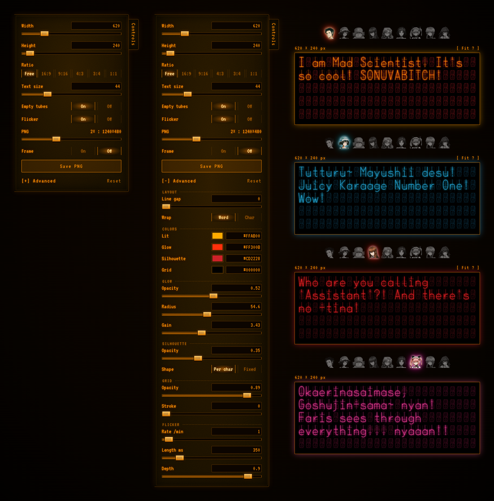

# Steins;Gate Nixie

A nixie tube text editor in the style of the Steins;Gate divergence meter.

**Live:** https://Salierigator.github.io/steins-gate-nixie




## What's in it?

**- Divergence meter:** A simple widget that can display the divergence value.

**- Nixie text editor:** Type anything for nixie style text. \:)

**- Character presets:** Nine Steins;Gate character sprites below the meter. Picking one sets a new set of default colors.

## How's it made?

Same recipe as the *Steins;Gate Visual Works 1.5 + NiXie Font Kit*: each tube is made of 4 layers, from bottom to top:

1. **Silhouette:** The unlit cathodes stacked behind.
2. **Glow:** The lit character, blurred.
3. **Lit:** The character itself.
4. **Grid:** The mesh in front.

I rebuilt the nixie characters in `assets/nixie-glyphs.json` and `assets/nixie-sprite.svg` from the fonts on the kit's disc (the original `.otf` files are not included in this repo).

You can change each layer's color under **Advanced** in Controls. That's how I made the character themes in the first screenshot, so have fun making your own colors. \:)

## Controls

**- Width / Height:** Frame size. Height is only a minimum, longer text makes the frame grow.

**- Ratio:** Locks the frame shape. Text that doesn't fit shows `[ Over 16:9 ! ]`.

**- Empty tubes:** Fill the rest of the frame with unlit tubes, or leave it black.

**- Frame:** Turn on to include the frame's border in the PNG.

**- Advanced:** Colors and fine tuning.

**`[ Fit ? ]`** shows up on the right above the frame when it can help. Click it to change the text size:

- Text overflowing a locked ratio → shrinks to fit.
- Lots of room left → grows to fill the frame.
- `can't fit` → even the smallest size is too big, please make the frame bigger.

## Notes

**-** Only the 113 BONX characters: ASCII plus a few symbols like `¥ © ® ™ †`. Anything else, like accented letters, shows as an empty tube.

**-** To get the divergence meter's decimal point, type `•` instead of `.`.

**-** With Frame on, the PNG gets the same margin on every side, so it won't keep a locked ratio exactly.

**-** `ß` is Upa, `∑` is a Gear.

## Run locally

```bash
python3 -m http.server 8000
```

Then open http://localhost:8000.

## Credits

This is a non-commercial fan project, not affiliated with or endorsed by the rights holders.

- *Steins;Gate* © 5pb. / Nitroplus
- Original nixie design by **SH@RP**
- Nixie construction and BONX font from *Steins;Gate Visual Works 1.5 + NiXie Font Kit* (font design by rendat)
- CRT look inspired by [cool-retro-term](https://github.com/Swordfish90/cool-retro-term) by Swordfish90
- Page fonts: VT323 and Chakra Petch, under the SIL Open Font License

## Use

The code is free to reuse. Everything under `assets/` belongs to its respective rights holders and is included here only for this fan project.
